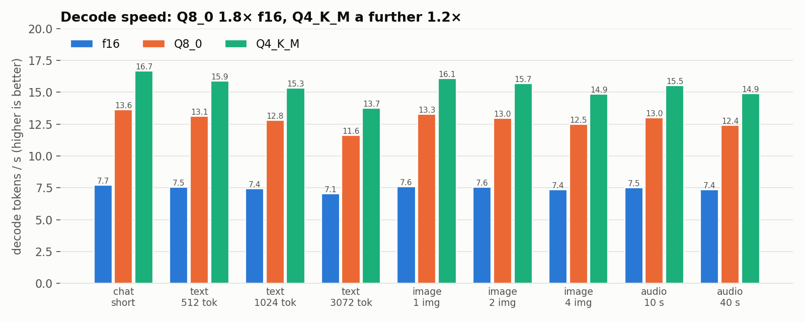
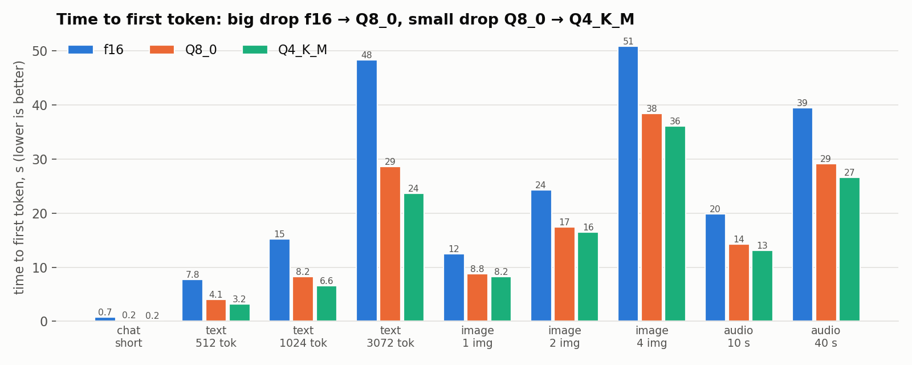
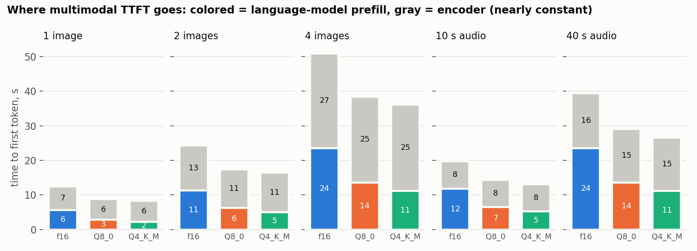
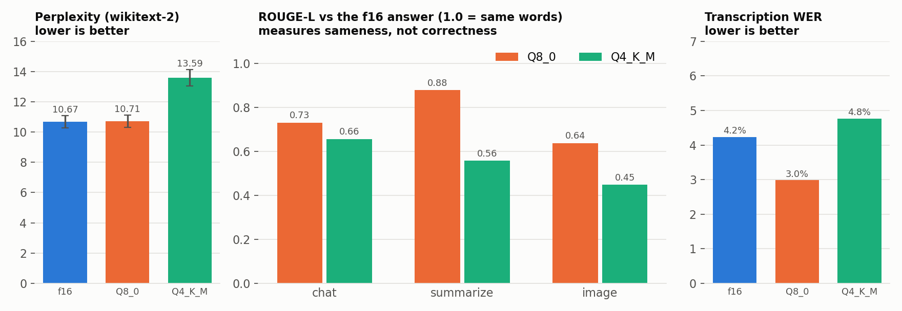
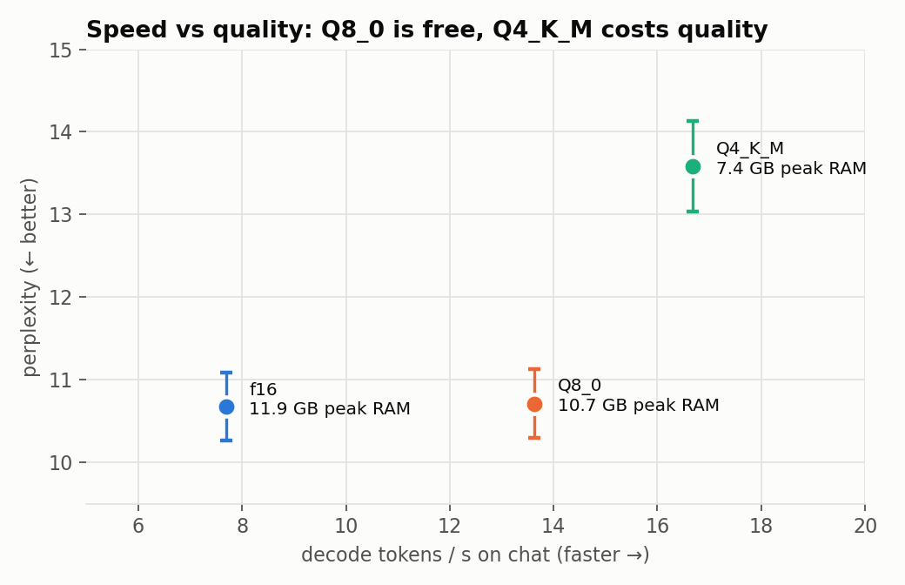

# Quantization row: f16 vs Q8_0 vs Q4_K_M on c7i.2xlarge

Baseline benchmarks, quantization variable. Same machine, same model, same workloads; only the weight format changes. Q8_0 is also the team-wide baseline that the other rows compare against.

## TL;DR

| | f16 | **Q8_0** (team baseline) | Q4_K_M |
|---|---|---|---|
| Decode speed (chat) | 7.7 tok/s | **13.6 tok/s** (1.8×) | 16.7 tok/s (2.2×) |
| TTFT, 3,072-token text | 48.3 s | **28.7 s** | 23.6 s |
| TTFT, 4 images | 50.9 s | **38.4 s** | 36.1 s |
| TTFT, 40 s audio | 39.5 s | **29.1 s** | 26.6 s |
| Peak RAM | 11.9 GB | **10.7 GB** | 7.4 GB |
| Perplexity (lower is better) | 10.67 | **10.71** (+0.4%, within error) | 13.59 (+27%) |
| Transcription WER | 4.2% | **3.0%** | 4.8% |

1. **Q8_0 is effectively free.** It's 1.8× faster at decode, with quality indistinguishable from f16. It's the right default, which supports using it as the team baseline.
2. **Q4_K_M buys a little more speed at a real quality cost.** Decode is only 1.2× faster than Q8_0, but perplexity rises 27% and open-ended answers drift. Its strong point is **RAM (−3.3 GB)**, which matters for 8 GB nodes.
3. **Quantization speeds up decode much more than time to first token.** Decode is limited by memory bandwidth; prefill and the encoders are limited by compute.
4. **Image and audio have a fixed encoder cost that quantization doesn't touch**: ~6 s per image and ~8 s per 30 s audio window in every run, because the encoder (mmproj) stays Q8_0. For 4 images that's two thirds of TTFT under Q4_K_M.
5. **The quality cost depends on the task.** Transcription barely changes (the audio pins down the answer); chat, summaries and image descriptions drift. That's relevant for routing: constrained tasks could go to cheaper Q4 nodes.

## Setup

| | |
|---|---|
| Machine | AWS c7i.2xlarge: 8 vCPU (4 physical cores, Intel Sapphire Rapids, AMX), 16 GB, Ubuntu 24.04, us-west-2 |
| Model | Qwen2.5-Omni-3B GGUF (ggml-org), language model in **f16 / Q8_0 / Q4_K_M**; image/audio encoder (mmproj) **Q8_0 in all runs** |
| Server | llama.cpp `llama-server`, build `b11960-8642541b2`, `-c 8192 -np 2 -t 8`, client on the same machine (no network in the timings) |
| Speed runs | `benchmark.py`: 9 workloads × 5 requests, one at a time, up to 128 output tokens, greedy decoding |
| Quality runs | `quality.py`: 10 inputs × 4 tasks per quant; `perplexity.sh`: wikitext-2, 20 chunks × 512 tokens |

Workloads: a short chat question; 512 / 1,024 / 3,072-token text (Dolly + CNN/DailyMail, summarize); 1 / 2 / 4 COCO photos; 10 s / 40 s LibriSpeech audio. Each repeat uses a different input; all three quants get the same inputs.

Raw data: `results/phase1/c7i.2xlarge__Qwen2.5-Omni-3B-{f16,Q8_0,Q4_K_M}/` and `results/quality/`. To regenerate the plots: `python analysis/quantization/make_plots.py`.

## 1. Decode speed

Decode (writing the answer) reads every weight once per generated token, so it's **memory-bound**: tokens/s ≈ memory bandwidth ÷ bytes of weights.

| | Approx. weight size | Decode tok/s | tok/s × size ≈ bandwidth used |
|---|---|---|---|
| f16 | ~6.2 GB (16 bits/weight) | 7.7 | ~48 GB/s |
| Q8_0 | ~3.3 GB (8.5 bits/weight) | 13.6 | ~45 GB/s |
| Q4_K_M | ~2.0 GB (~4.9 bits/weight) | 16.7 | ~33 GB/s |

*(Sizes are estimates for a ~3.1B-parameter language model, not measured file sizes.)*

- **f16 → Q8_0:** speed rises 1.77×, close to the 1.88× byte ratio, and the bandwidth used stays flat. That's what memory-bound looks like.
- **Q8_0 → Q4_K_M:** bytes drop another ~1.7×, but speed rises only 1.22×, and the bandwidth used *falls*. Q4_K_M is no longer limited by memory. Unpacking 4-bit values and their two-level scales costs CPU time, which matters with only 4 physical cores, and fixed per-token costs (KV cache, output layer) become a larger share.
- Decode slows slightly with longer prompts in every quant (e.g. Q8_0: 13.6 → 11.6 tok/s from chat to 3,072 tokens), because each new token attends over a longer KV cache.

## 2. Time to first token

TTFT is encoding (image/audio) plus prefill (reading the prompt). Prefill processes many tokens at once, reusing each weight read many times, so it's **compute-bound**.

From a linear fit of TTFT against prompt tokens on the text runs, the prefill cost is:

| | Prefill cost | 3,072-token TTFT |
|---|---|---|
| f16 | 15.7 ms / token | 48.3 s |
| Q8_0 | 9.4 ms / token | 28.7 s |
| Q4_K_M | 7.8 ms / token | 23.6 s |

- **f16 → Q8_0 is a big drop (−40%).** Part of the reason is that llama.cpp's **AMX (Intel's matrix unit) kernels cover Q8_0 and Q4_K but not f16**, so f16 prefill runs on slower code paths. The perplexity runs show the same: f16 took 31 s per pass vs 13 s (Q8_0) and 12 s (Q4_K_M).
- **Q8_0 → Q4_K_M is a small drop (−18%).** Both end up doing int8 math; Q4 only saves some memory traffic.
- TTFT was very repeatable: within 1% across the 5 repeats for text and audio. Image TTFT varies more across repeats (e.g. 6–13 s for 1 image) because each repeat is a different photo, and photos turn into 274–523 tokens depending on their resolution.

### Where multimodal TTFT goes

Subtracting the text-only prefill estimate from each image/audio TTFT leaves the **encoder time** (gray). It's nearly the same in all three runs: **~6 s per image** (7 s with f16) and **~8 s per 30 s audio window** (16 s for 40 s of audio, which takes two windows). That's expected, since the encoder is Q8_0 in every run.

So **quantizing the language model can't shrink a large part of multimodal TTFT**: for 4 images under Q4_K_M, 25 of 36 s is encoding. Quantizing the encoder too would be a natural follow-up.

*Method caveat: this is an estimate from a straight-line fit, not a measured split. Image tokens may be slightly more expensive to prefill than text tokens, which would make the gray part a bit smaller than shown.*

## 3. Answer quality

Three measures, because none is enough on its own:

- **Perplexity**: how "surprised" the model is by real text. It's absolute, low-noise, and doesn't depend on decoding. **Q8_0: 10.71 vs 10.67 for f16**, a difference well inside the ±0.41 error bar. **Q4_K_M: 13.59, +27%.** That's a large increase. Small models are hit harder by 4-bit than large ones, because each weight carries more of the model's knowledge.
- **ROUGE-L vs the f16 answer**: word overlap with what f16 said (1.0 = identical). It measures **sameness, not correctness**. Even Q8_0 scores only 0.64–0.88, because greedy decoding picks the single most likely token: when two candidates are nearly tied, a tiny numeric difference flips the choice and the rest of the answer follows a different path. Q4_K_M drifts more (0.45–0.66), most on image descriptions. In the samples we read side by side (e.g. the first image), the Q4_K_M answer was still a reasonable description, just worded differently; a correctness judgment would need human or LLM-judge scoring.
- **Transcription WER** vs the LibriSpeech reference: **4.2% / 3.0% / 4.8%**. With 10 clips, Q8_0 beating f16 is noise. Part of the floor comes from the reference spelling itself (e.g. the reference text says "nomes" where every model correctly writes "gnomes").

**Why transcription survives quantization:** the audio constrains the answer, so at each step the correct word is far more likely than any alternative, and small numeric noise can't overturn a big margin. Open-ended tasks have many near-ties and are fragile. This is a per-modality difference in quantization sensitivity, which matters for routing.

## 4. Speed vs quality vs memory

- **Peak RAM:** 11.9 / 10.7 / 7.4 GB. f16 and Q8_0 are closer than their file sizes suggest; we think that's because llama.cpp builds a second, AMX-friendly copy of the Q8_0 weights at load (Q8_0 peaks were similarly high on c7i and c8g in the team runs). Peak RAM climbs ~2 GB over the run in every quant (it's a running peak, and later workloads have longer inputs).
- **Only Q4_K_M leaves real headroom on an 8 GB node.** Q8_0 peaked at 10.7 GB here, which matters for the vCPU row's c7i.xlarge (8 GB).

## What this means for routing

- **Q8_0 as the default node format** is justified: there's no measurable quality loss and it's 1.8× faster than f16.
- **A Q4_K_M node is worth having for specific traffic:** short chat and transcription get most of the speed gain with little quality loss, and Q4 fits small-memory nodes. Long summaries and image descriptions are where its quality cost shows; those are better sent to Q8_0 nodes.
- **Image and audio TTFT is dominated by a fixed encoder cost** that the language model's format doesn't change. A router should model it separately (~6 s per image, ~8 s per 30 s audio window on this machine) rather than scaling by prompt tokens alone.

## Caveats

- **Small samples:** 5 requests per speed workload; 10 inputs per quality task. Speed numbers are tight (TTFT within 1% across repeats for text and audio), but quality differences of a few points are within noise, except perplexity, which has a computed error bar.
- **Concurrency 1 only.** Two requests at once (the server allows two slots) may change the picture, especially for compute-bound prefill.
- **Output lengths differ across quants** (greedy answers diverge), so compare tokens/s and TTFT, not total request time.
- **Plain Q4_K_M** (no importance matrix). Calibrated 4-bit methods (imatrix, AWQ, GPTQ) usually lose less quality at the same size.
- **One machine type.** The f16 prefill penalty is partly specific to AMX machines; on c7a (AMD) or c8g (Graviton) the f16 vs Q8_0 gap may differ.
