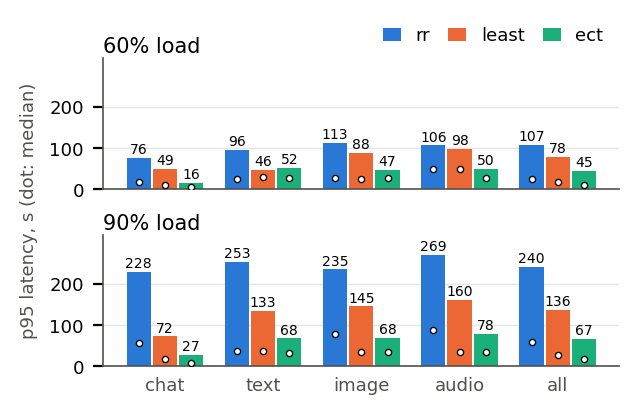
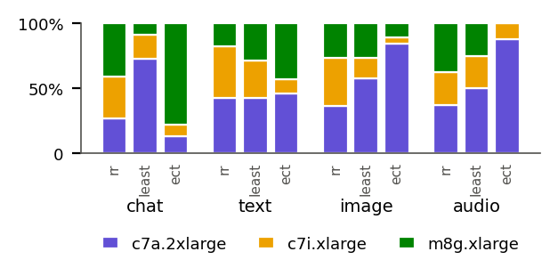
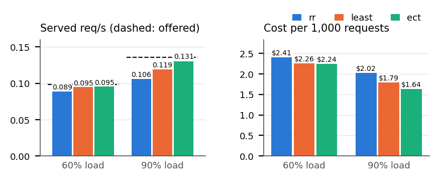

# Routing Benchmarks: Results

Setup and how to run: [`docs/routing-benchmark.md`](../../docs/routing-benchmark.md). Raw data: [`results/routing/`](../../results/routing/). Regenerate the tables and figures: `python analysis/routing/analyze_routing.py`. The same write-up as a Word document: `routing-results.docx`.

The baseline benchmarks showed that no CPU architecture is fastest for every modality: chat ran fastest on Graviton, images and audio on AMD, and long text on AMD or on Intel with AMX. A request's modality is known when it arrives, so we benchmarked how much a router gains by using it, on a small cluster of different CPUs under realistic traffic.

**Cluster.** AWS limited us to 16 vCPUs, so we chose three nodes with different strengths: c7a.2xlarge (AMD; fastest encoder and prefill; 2 slots), c7i.xlarge (Intel with AMX; prefill and overflow; 1 slot, 8 GB) and m8g.xlarge (Graviton4; fastest decode; 16 GB for Q8_0; 2 slots). All serve Qwen2.5-Omni-3B Q8_0 on the same llama.cpp build, so answers are identical and only speed differs. The cluster costs $0.77/hour. Each node was profiled on itself right before the runs (Table 1).

**Table 1: Routing cluster profile.** Time per request alone (s), throughput gain from the second slot, and capacity for the trace mix. Bold: fastest node.

|             | chat    | text 3k tok | 4 images | 40 s audio | slot gain | capacity (req/s) |
| ----------- | ------- | ----------- | -------- | ---------- | --------- | ---------------- |
| c7a.2xlarge | 10.9    | **31.9**    | **28.5** | **27.9**   | 1.39      | 0.088            |
| c7i.xlarge  | 17.5    | 64.0        | 76.4     | 65.9       | 1.00      | 0.031            |
| m8g.xlarge  | **5.9** | 126.7       | 99.7     | 110.8      | 1.01      | 0.029            |

**Traffic.** Open loop: requests arrive by a Poisson process whether or not earlier ones have finished, for 15 minutes. Mix: 50% chat, 20% text, 15% image, 15% audio, each with a different input. The trace is generated once from a seed, so every policy replays exactly the same requests at the same times. Two loads: 85 requests at 0.099 req/s and 122 requests at 0.136 req/s, i.e. 67% and 92% of the cluster's predicted capacity (we call them "60%" and "90%", the generation targets).

**Policies.** We compare three well-known approaches that differ in what they know when a request arrives; a node queues the request if its slots are busy. *rr* (round robin, the load-balancer default) knows nothing. *least* (join the shortest queue) knows each node's load, as requests in flight per slot, but treats all requests and nodes alike. *ect* (minimum completion time) also knows the request's modality and each node's speed: it sends the request to the node with the smallest (backlog + profiled time of this request) / slot gain, where the backlog is the predicted work already sent to the node. *rr* vs. *least* isolates the value of knowing load; *least* vs. *ect* the value of knowing the request.

## Results

**Figure 1: Routing on estimated completion time cuts tail latency for every modality.** p95 end-to-end latency (bars) and median (dots) per modality and policy; same trace for every policy; every request completed.

- **Knowing the request matters most under load (Fig. 1).** At 90% load, p95 latency over all requests was 240 s for *rr*, 136 s for *least* and 67 s for *ect*: knowing load roughly halves it, and also knowing the request halves it again. At 60%, *ect* still cut p95 from 78 to 45 s compared with *least*.
- **Only ect keeps up at 90% load (Fig. 3).** It served 0.131 of the 0.136 req/s offered; *rr* (0.106) and *least* (0.119) fell behind, so their queues grew for the whole run.

**Figure 2: ect sends each modality to its fastest node.** Share of each modality sent to each node, at 90% load.

- **Each modality goes to its fastest node (Fig. 2).** *ect* sent 78–88% of chat to the m8g and 84–100% of images and audio to the c7a. Chat p95 at 90% load fell from 228 s (*rr*) and 72 s (*least*) to 27 s. *least* did the opposite with chat: it sent 73% to the c7a, whose two fast slots made it look least busy.
- **Text is the exception.** At 60% load *least* had a lower text p95 (46 vs. 52 s): *ect* also sent some 1,024-token text to the m8g, whose prefill is slowest.

**Figure 3: Only ect keeps up at 90% load, and it is the cheapest per request.** Served vs. offered requests/s (dashed), and cost per 1,000 requests.

- **Cost follows latency (Fig. 3).** A policy that falls behind pays to drain its queue: at 90% load *ect* cost $1.64 per 1,000 requests vs. $2.02 for *rr* (19% less). Higher load lowers cost per request but raises latency.
- **A simple cost model is enough.** *ect* predicts each request's time from profiles of requests running alone and ignores interference between co-running requests; its median prediction error grew only from 29% to 34% between the two loads.
- **Memory is a per-node budget, not a function of load.** The 8 GB c7i ran out of memory with 2 slots of image requests, and again from llama-server's default 8 GB prompt cache; with 1 slot and no cache it stayed under 6.2 GB, and the affected runs were repeated. While it was down, *least* kept choosing it, since a node that fails instantly looks idle: routers need health checks.

## Scope

These results describe the conditions we benchmarked: one model and quantization (Qwen2.5-Omni-3B Q8_0), one 3-node cluster in one AWS region (so network delay is negligible), one traffic mix at two loads below capacity, one trace seed with one run per policy and load, and requests assigned to a node as they arrive. Because each configuration ran once, we read only large differences. We did not vary the traffic mix, load above capacity, network conditions, or the number and size of nodes, and did not test holding requests at the router, autoscaling, or routing that also uses prompt length or interference between requests; these are natural next benchmarks.

## For the report

Figures are in this folder: `.pdf` for LaTeX, `.png` for Word or slides.

| File                       | Figure                                                               |
| -------------------------- | -------------------------------------------------------------------- |
| `routing_latency`          | Fig. 1: p95 and median latency per modality and policy, both loads   |
| `routing_placement`        | Fig. 2: share of each modality sent to each node, 90% load           |
| `routing_throughput_cost`  | Fig. 3: served vs. offered req/s, and cost per 1,000 requests        |

**All numbers, median / p95 latency (s):**

| Load | Modality | rr       | least        | ect         |
| ---- | -------- | -------- | ------------ | ----------- |
| 60%  | all      | 25 / 107 | 18 / 78      | **11 / 45** |
|      | chat     | 18 / 76  | 11 / 49      | **6 / 16**  |
|      | text     | 25 / 96  | 30 / **46**  | 27 / 52     |
|      | image    | 28 / 113 | 26 / 88      | 27 / **47** |
|      | audio    | 50 / 106 | 49 / 98      | **28 / 50** |
| 90%  | all      | 58 / 240 | 28 / 136     | **17 / 67** |
|      | chat     | 58 / 228 | 16 / 72      | **8 / 27**  |
|      | text     | 36 / 253 | 36 / 133     | **32 / 68** |
|      | image    | 79 / 235 | **34** / 145 | 36 / **68** |
|      | audio    | 88 / 269 | **34** / 160 | 35 / **78** |

| Load | Offered (req/s) | Served (req/s): rr / least / ect | $ per 1k requests: rr / least / ect |
| ---- | --------------- | -------------------------------- | ----------------------------------- |
| 60%  | 0.099           | 0.089 / 0.095 / 0.095            | 2.41 / 2.26 / 2.24                  |
| 90%  | 0.136           | 0.106 / 0.119 / **0.131**        | 2.02 / 1.79 / **1.64**              |
