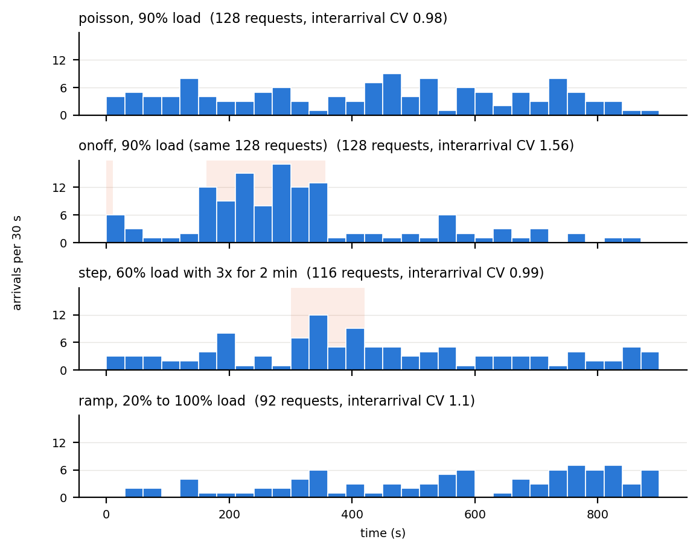

# Phase 2: Traffic Generation (`src/tracegen.py`)

`tracegen.py` creates the request traffic for the Phase 2 routing experiments. It writes a **trace**: a list of requests, each with an arrival time, a workload (chat, text, image or audio, at one of the 9 benchmark sizes), which dataset input to use, and a deadline. `loadgen.py run` replays a trace against the cluster, sending each request at its arrival time whatever the cluster is doing (open loop), so every routing policy faces exactly the same traffic.

What it adds over the Phase 1 traces (`loadgen.py trace`, steady Poisson arrivals only):

- **Arrival patterns:** steady, bursty, a sudden spike, a gradual ramp, or the timing of a real trace.
- **Load as a fraction of capacity:** `--load 0.9` means 90% of what the cluster can sustain for that mix, computed from the node profiles.
- **Workload mixes:** named presets for training and held-out evaluation, or any custom mix.
- **Deadlines:** a deadline per request, so SLO attainment can be measured the same way for every policy.
- **Comparable traces:** with one seed, every trace contains the same requests in the same order; only the arrival times differ.
- **Inspection:** `describe` prints a trace's rate, burstiness and mix; `plot` draws its arrivals over time.

## Quick start

From the repository root (Python 3 with the packages in `requirements.txt`):

```bash
# 15 minutes of steady traffic at 90% of the cluster's capacity, default mix, seed 1
python src/tracegen.py make --arrivals poisson --load 0.9 --nodes nodes.json --seed 1
#   -> traces/phase2/poisson-default-load0.9-dur900-seed1.csv  (+ .json)

# the same requests, arriving in bursts
python src/tracegen.py make --arrivals onoff --load 0.9 --nodes nodes.json --seed 1

# check them, then replay one with a routing policy
python src/tracegen.py describe traces/phase2/*.csv
python src/tracegen.py plot traces/phase2/*.csv -o arrivals.png
python src/loadgen.py run --trace traces/phase2/onoff-default-load0.9-dur900-seed1.csv --nodes nodes.json --policy ect --cluster C
```

`--nodes` points to the cluster's `nodes.json` (the same file `loadgen.py` uses). It provides the capacity for `--load` and the solo times for deadlines. Without it, give `--rate` in requests per second (or `--load` with `--capacity`), and deadlines are left empty.

## How it works

### Arrival patterns



*Arrivals per 30 s for four traces made with seed 1 on the routing cluster. Shaded: bursts and the step. The steady and bursty traces contain the same 128 requests.*

| `--arrivals` | Pattern | Rate meaning | Options (defaults) |
| --- | --- | --- | --- |
| `poisson` | Steady: independent arrivals at a constant mean rate | Mean rate | none |
| `onoff` | Bursty: alternates between bursts and quieter periods, both of random length | Mean rate over the whole trace; bursty and steady at the same load carry the same total work | `--burst-factor` (3): rate in a burst ÷ mean rate; `--burst-fraction` (0.2): share of time in bursts; `--burst-length` (60 s): mean burst length |
| `step` | Flash crowd: steady, then a sudden multiple of the rate for a while, then steady again | Rate outside the step | `--step-at` (300 s), `--step-length` (120 s), `--step-factor` (3) |
| `ramp` | Load that rises (or falls) linearly over the trace | `--rate` is multiplied by the ramp | `--ramp-from` (0.3), `--ramp-to` (1.2) |
| `replay` | The timing of a real trace, scaled to our rate | Mean rate | `--replay` (CSV), `--replay-column` (`timestamp`), `--replay-unit` (`s`/`ms`/`us`), `--replay-offset` (0) |

**Replay** takes `rate × duration` consecutive arrivals from the real trace, starting at `--replay-offset`, and stretches them to fill the duration. That keeps the real trace's burstiness and ordering at a rate our small cluster can handle; a different offset gives a different window. It replays arrival times only: workloads still come from `--mix`.

### Workload mixes

| `--mix` | chat / text / image / audio (%) | Intended use |
| --- | --- | --- |
| `default` | 50 / 20 / 15 / 15 | The routing benchmarks' mix; training mix |
| `chat-heavy` | 80 / 10 / 5 / 5 | Held out (proposed) |
| `text-heavy` | 20 / 60 / 10 / 10 | Held out (proposed) |
| `image-heavy` | 20 / 10 / 60 / 10 | Held out (proposed) |
| `audio-heavy` | 20 / 10 / 10 / 60 | Held out (proposed) |
| `uniform` | 25 / 25 / 25 / 25 | Balanced reference |

Within a modality, its sizes are equally likely (e.g. text is 512, 1,024 or 3,072 tokens). A custom mix uses the same syntax as `loadgen.py`: `--mix chat=40,text=40,image=20`, or workload ids for single sizes, e.g. `--mix 00=50,03=50` (chat and 3,072-token text only).

### Deadlines

Each request gets `deadline_s` = its modality's factor × the fastest solo time of its workload on any node (from the profiles in `nodes.json`). The default `--slo chat=3,text=4,image=4,audio=4` gives, on the routing cluster, 17.8 s for chat (3 × 5.9 s on the m8g) and 127 s for 3,072-token text (4 × 31.9 s on the c7a). The deadline is relative to arrival. A request meets its SLO if it finishes within `deadline_s` of arriving.

### Comparable traces

All arrival patterns are built from the same random stream (a time-rescaled unit-rate Poisson process), and the workloads are drawn from a second, separate stream in arrival order. So with one `--seed`:

- request *k* has the same workload and dataset input in every trace, whatever the pattern, load or rate;
- steady and bursty traces at the same load contain exactly the same requests;
- different seeds give independent traces, for repeated runs.

This makes differences between runs attributable to the arrival pattern or load, not to a different set of requests.

## Commands

| Command | Does |
| --- | --- |
| `make` | Write one trace (CSV + JSON). Options above, plus `--duration` (900 s), `--seed` (1), `--out` (default `traces/phase2/<arrivals>-<mix>-<load or rate>-dur<duration>-seed<seed>.csv`). |
| `describe TRACE...` | Print each trace's requests, span, mean rate, interarrival CV, peak 60 s load and requests per modality. Works on Phase 1 traces too. |
| `plot TRACE... [-o out.png] [--bin 30] [--labels ...]` | Arrivals per time bin, one panel per trace, bursts shaded (from the JSON file). |

`python src/tracegen.py make --help` lists every option.

## Output

**Trace CSV.** `loadgen.py run` replays it unchanged: it reads the first six columns and ignores the rest.

| Column | Meaning |
| --- | --- |
| `id` | Request number, in arrival order |
| `arrival_s` | Arrival time, seconds from the start of the run |
| `run`, `modality`, `size` | Workload: one of the 9 in `benchmark.py` `RUNS` |
| `input` | Which input of that modality's dataset; a new one per request (0 is kept for the warm-up) |
| `slo_factor` | Deadline as a multiple of the workload's fastest solo time |
| `deadline_s` | Deadline relative to arrival, s (empty without `--nodes`) |
| `burst` | 1 if the request arrived during a burst or step, for analysing latency in bursts |

**JSON file** (same name): every parameter, the mix, the rate and capacity used, the rate segments (when bursts happened), and summary statistics:
- requests and mean rate;
- **interarrival CV:** the spread of gaps between arrivals; 1 for Poisson, above 1 for bursty traffic;
- **peak 60 s load:** the busiest minute relative to the average;
- requests per modality.

## What depends on the cluster

Arrival patterns, mixes and the request sequence don't depend on the hardware. Two things do, because they come from the node profiles in `nodes.json`:
- the request rate for a given `--load`;
- `deadline_s`.

If the cluster changes, profile the new nodes and regenerate traces with the new `nodes.json` and the same seeds. The requests stay the same; only rates and deadlines move.

## Example: a standard set of traces

```bash
for seed in 1 2 3; do
  for load in 0.3 0.6 0.9 1.1; do
    for arr in poisson onoff; do
      python src/tracegen.py make --arrivals $arr --load $load --nodes nodes.json --seed $seed
    done
  done
  for mix in image-heavy audio-heavy text-heavy; do
    python src/tracegen.py make --arrivals poisson --load 0.9 --nodes nodes.json --mix $mix --seed $seed
  done
done
```

At ~17 minutes per run and policy, a full set takes many hours on AWS. Pick a subset for AWS runs and use a simulator for the rest.

## Not supported yet

- **Continuous request sizes** (any token count, 1–4 images, any audio length): needs the dataset scripts to accept any size, and `loadgen.py run` to read `size` from the trace.
- **Multi-turn sessions** with growing context: needs `loadgen.py run` to send turn *k*+1 only after turn *k*'s answer, with the earlier turns in the prompt.
- **Token counts from real traces:** `replay` uses only arrival times.
- **Trimming warm-up and drain:** belongs in the analysis, not the trace.

## Plan

How we're expanding the traffic generator beyond the Phase 1 traces.

| Addition | Why | How |
|---|---|---|
| **Bursty arrivals** | Required by the project. A router queue only pays off when arrivals bunch up. | An on/off (two-state) process with the **same mean rate** as the Poisson trace, so steady and bursty are directly comparable. Parameters: burst rate multiplier (e.g. 3×), burst length, idle length. Also a single step ("flash crowd") trace. |
| **Load sweep** | One 60% and one 90% run is too thin. | Rates from about 30% to about 110% of capacity, including short periods above capacity. |
| **Held-out mixes** | Required: tune on one mix, test on others. | A training mix (today's) plus held-out mixes: chat-heavy, image-heavy, audio-heavy, long-text-heavy. Fix which ones are held out before anyone tunes. |
| **Continuous request sizes** | The new cost model uses actual prompt tokens, and fixed sizes favour a lookup table like `ect`'s. | Text from about 100 to 3,500 tokens, 1–4 images, audio from 5 to 40 s, drawn from distributions. Keep the 9 fixed sizes as one option. |
| **Deadlines in the trace** | The SLO-aware router needs them, and every policy must be judged against the same deadlines. | A `deadline_s` column per request, e.g. k × the request's best solo time on any node, with k per type (tight for chat, looser for audio). |
| **Multi-turn sessions** | The spec asks for "the cost of sending accumulated context" and to "avoid moving an active session". | Sessions with a `session_id` and turn number, think time between turns, and prompts that include the earlier turns. Turns within a session run one after another; sessions arrive independently of each other. |
| **Real trace replay** | The "live trace replay" task: realistic burstiness. | Public LLM traces with arrival times and token counts, e.g. the Azure LLM inference traces or BurstGPT. Rescale their rate to our cluster (about 0.15 req/s) and map token counts onto our workloads. Check each trace's current format before relying on it. |
| **Seeds and length** | 85–122 requests per run gives a noisy p95. | 3 seeds per configuration, longer runs, and leave out a warm-up and the drain at the end when computing statistics. |

**Status:**
- **Done in `tracegen.py`:** bursty arrivals (plus step and ramp), load sweep (`--load`), held-out mixes (`--mix`), deadlines (`--slo`), real trace replay for arrival times (`--arrivals replay`), seeds and duration.
- **Still needed:** the runner logging whether each request met its deadline; trimming warm-up and drain in the analysis.
- **To do:** continuous request sizes, multi-turn sessions, token counts from real traces (see "Not supported yet").
